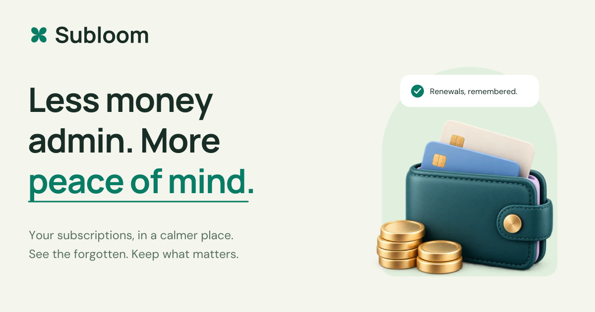

<p align="center">
  <a href="https://subloom-landing.baltii.tn">
    <picture>
      <source media="(prefers-color-scheme: dark)" srcset="public/social-dark.png">
      <source media="(prefers-color-scheme: light)" srcset="public/social.png">
      
    </picture>
  </a>
</p>

<h1 align="center">Subloom Website</h1>

<p align="center">
  <strong>A calmer first look at your subscriptions.</strong><br>
  The product website and download home for Subloom.<br>
  Explore the app, try an interactive sample, and choose where to get started.
</p>

<p align="center">
  <a href="https://subloom-landing.baltii.tn"></a>
  <a href="https://github.com/Baltii/Subloom-Landing/actions/workflows/ci.yml"></a>
  <a href="https://subloom-landing.baltii.tn"></a>
  <a href="https://github.com/Baltii/Subloom/releases"></a>
</p>

<p align="center">
  <a href="package.json"></a>
  <a href="package.json"></a>
  <a href="tsconfig.json"></a>
  <a href=".nvmrc"></a>
  <a href="package.json"></a>
</p>

<p align="center">
  
  
  
  
</p>

<p align="center">
  <strong><a href="https://subloom-landing.baltii.tn">Visit the website ↗</a></strong>
  &nbsp;·&nbsp; <a href="https://subloom-landing.baltii.tn/download">Download Subloom</a>
  &nbsp;·&nbsp; <a href="https://subloom.baltii.tn">Open the app</a>
  &nbsp;·&nbsp; <a href="https://github.com/Baltii/Subloom">App repository</a>
</p>

<p align="center">
  <a href="#about-the-project">About</a> ·
  <a href="#what-you-can-explore">Features</a> ·
  <a href="#downloads-that-stay-current">Downloads</a> ·
  <a href="#run-it-locally">Run locally</a> ·
  <a href="#project-structure">Project structure</a> ·
  <a href="#deployment">Deployment</a>
</p>

---

## About the project

Subloom helps people bring their subscription records, recurring costs, and upcoming renewals into one clear view. This website introduces that experience with product illustrations, an interactive cost sample, and a straightforward route into the app.

Visitors can explore the product before committing to a download, open the browser app, or find an installer for their device. The tone follows the product: friendly, calm, and focused on making the next step easy to understand.

This repository contains the **public website**, built with Next.js. The subscription-tracking application lives in the [separate Subloom app repository](https://github.com/Baltii/Subloom). The website has its own source, checks, and Vercel deployment, so it can evolve independently from the Expo app.

## What you can explore

| Feature | What it brings to the website |
| --- | --- |
| **A clear introduction** | Product previews and illustrated sections explain subscription overviews, recurring costs, renewals, statement review, and original-currency records. |
| **An interactive cost sample** | Switch between monthly and yearly totals and toggle sample subscriptions to see how recurring costs add up. |
| **Two clear ways to start** | Consistent calls to action offer **Open in browser** and **Download the app** throughout the landing page. |
| **A device download page** | Android, Apple silicon Mac, Intel Mac, and Windows choices connect directly to available official release files. |
| **One shared experience** | Both routes use the same page frame, navigation, footer, theme roles, and FAQ component. |
| **Light, dark, and system themes** | Appearance follows a saved preference or the system, with a theme selector available in the shared navigation. |
| **Considered motion** | Gentle entrances, interactive feedback, pause/play controls, and reduced-motion support keep the page comfortable to use. |
| **Keyboard-friendly controls** | Skip navigation, visible focus, labeled controls, accessible accordion state, and native FAQ fallbacks support different ways of browsing. |

The subscription records and prices shown in the website’s previews are illustrative. Changing the sample does not manage real subscriptions or cancel merchant billing. Subloom’s guest tracking can start without an account or bank connection; optional account sync belongs to the app.

## Downloads that stay current

[The download page](https://subloom-landing.baltii.tn/download) reads the latest published release from [Baltii/Subloom](https://github.com/Baltii/Subloom/releases/latest). It displays available installers, file sizes, release notes, and SHA-256 checksum links when supplied by the release.

| Platform | Download or starting point |
| --- | --- |
| **Android** | The release’s APK, with a test-build notice when the filename identifies a test APK. |
| **macOS** | Separate Apple silicon and Intel ZIPs. The app requires macOS 14 or later. |
| **Windows** | The release’s 64-bit Windows installer. |
| **Web** | [Open Subloom](https://subloom.baltii.tn) without installing anything. |
| **iPhone / iPad** | Use the browser app; a public native iOS installer is not currently offered. |

Release data uses Next.js server fetching with a **60-second revalidation interval**. Installer links can refresh after a new app release without a website redeployment. They are derived from GitHub’s release response rather than hardcoded versioned URLs.

If GitHub is unavailable or a platform file is missing, the page explains the unavailable state and keeps a link to the official release page. Download asset URLs are checked against the Subloom GitHub repository before being displayed.

<details>
<summary><strong>Installation notes</strong></summary>

Windows installers are unsigned. Mac apps are ad-hoc signed and are not notarized by Apple. Android test APKs use a test signing key and cannot update a store-signed installation; export guest data before replacing an existing installation. The browser app remains an alternative when installation is not suitable.

</details>

## Built with

| Part | Technology |
| --- | --- |
| Framework | Next.js 16 App Router, with server-rendered content and client components for interaction |
| Interface | React 19 and TypeScript 5.9 |
| Styling | Plain CSS, semantic color variables, and responsive layouts |
| Typography | Locally bundled Manrope and DM Sans |
| Icons | Lucide, alongside the canonical Subloom brand assets |
| Release source | GitHub’s public releases API |
| Hosting and delivery | Vercel Git deployments and GitHub Actions |
| Local tooling | Node.js 24 and npm with a committed lockfile |

## Run it locally

Use **Node.js 24**, as specified in [`.nvmrc`](.nvmrc).

```sh
git clone https://github.com/Baltii/Subloom-Landing.git
cd Subloom-Landing
npm ci
npm run dev
```

Open **[localhost:3000](http://localhost:3000)**. The dev server binds to `127.0.0.1` by default.

The current website does not require an environment file to run. Release information comes from GitHub’s public API; temporary API failures use the page’s fallback state. App accounts, bank-statement imports, and other product integrations are implemented in the separate application project.

### Checks and production preview

```sh
npm run typecheck
npm run build
npm run start
```

`npm run start` serves the production build on the same local address after a successful build. GitHub Actions runs the TypeScript check and production build for pull requests and pushes to `main`.

## Project structure

```text
app/
  layout.tsx                 Fonts, metadata, theme bootstrap, shared site layout
  page.tsx                   Landing page and product story
  globals.css                Shared layout, controls, FAQ, and motion styles
  theme.css                  Semantic light/dark colors and shared actions
  features.css               Product-feature presentation
  download/
    page.tsx                 Device downloads and installation FAQ
    release.ts               Release fetching, validation, and asset selection
    download.css             Download-specific layout and animation
components/
  site-layout.tsx            Shared header, main frame, and footer
  experience.tsx             Navigation, FAQ, previews, sample, and motion controls
  app-actions.tsx            Shared browser/download CTA pair
  theme.tsx                  Appearance selector
  brand.tsx                  Canonical Subloom logo component
public/
  brand/                     Brand SVG assets
  fonts/                     Local fonts and their licenses
  illustrations/             Product illustrations
  social.png                 Light README and social banner
  social-dark.png            Dark README and social banner
.github/workflows/ci.yml      Website checks
```

## Design and assets

The website shares Subloom’s visual identity with the app: **cloud** `#F8FAF8`, **forest** `#182D25`, and **green** `#087C65`, with a dark ground of `#101A16` and mint actions of `#70D2AD`. Manrope carries headings; DM Sans carries reading text and controls.

Flat surfaces, rounded shapes, generous spacing, and the existing product illustrations keep both pages connected. Reuse `SiteLayout`, `FaqList`, `AppActions`, and `Motion` when extending the site so navigation, FAQs, actions, and motion behavior stay consistent.

Banner artwork, illustrations, logos, and fonts are stored in this repository. Font license files are included under [`public/fonts`](public/fonts). The README banner switches between the existing light and dark artwork to suit the viewer’s preferred color scheme.

## Deployment

The production website is **[subloom-landing.baltii.tn](https://subloom-landing.baltii.tn)**. The production branch is `main`; Vercel builds and deploys it independently from the application repository. Both page routes use the custom domain for canonical URLs.

| Destination | Purpose |
| --- | --- |
| [Website](https://subloom-landing.baltii.tn) | Product introduction and interactive sample |
| [Downloads](https://subloom-landing.baltii.tn/download) | Installers and installation help |
| [Browser app](https://subloom.baltii.tn) | The Subloom application |
| [App releases](https://github.com/Baltii/Subloom/releases) | Official release files and notes |

For a change, run the checks, open a pull request against `main`, review its preview deployment, and merge when ready. Keep app credentials and private configuration out of this repository. Generated builds and local agent/design workspaces are ignored.

## Contributing

Keep changes focused and preserve the shared brand, keyboard support, theme behavior, and reduced-motion path. For visual updates, check desktop and mobile layouts in both light and dark appearances. For download changes, verify the missing-asset and API-error states as well as the available installers.

Use a Conventional Commit message such as `fix(download): clarify Mac installation` or `docs: improve local setup`. [Open an issue](https://github.com/Baltii/Subloom-Landing/issues) for a website bug or suggestion; product and app issues belong in the [Subloom app repository](https://github.com/Baltii/Subloom/issues).

---

<p align="center">
  Built with care by <a href="https://github.com/Baltii">@Baltii</a>.<br>
  <sub>A little less admin. A little more life.</sub>
</p>
